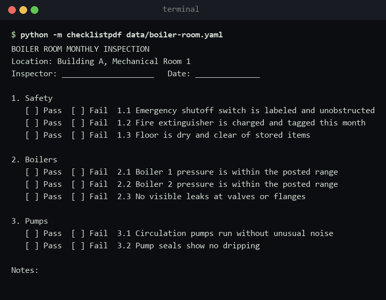

# inspection-checklist-as-code

Keeps each inspection checklist as a YAML file and renders it as a printable text page or a PDF.



## What it is for

Building inspections are often run from checklists that live in word processor files, drift between sites, and cannot be reviewed like other changes. A building manager, safety officer or maintenance planner keeps each checklist as a small YAML file in version control, so every change is visible and reviewable. They print a page with a pass and fail box per item, as text or as a PDF, whenever a round is due.

## Install

```
git clone <this repo> && cd inspection-checklist-as-code
python -m pip install -e .
python -m pytest -q
```

## How to use

| I want to | Command |
|---|---|
| Print a checklist as text | `python -m checklistpdf data/boiler-room.yaml` |
| Write the checklist as a PDF | `python -m checklistpdf data/boiler-room.yaml --pdf boiler-room.pdf` |
| See the built-in help | `python -m checklistpdf --help` |

Worked example (first lines shown):

```
python -m checklistpdf data/boiler-room.yaml
```

```
BOILER ROOM MONTHLY INSPECTION
Location: Building A, Mechanical Room 1
Inspector: ____________________   Date: ______________

1. Safety
   [ ] Pass  [ ] Fail  1.1 Emergency shutoff switch is labeled and unobstructed
   [ ] Pass  [ ] Fail  1.2 Fire extinguisher is charged and tagged this month
   [ ] Pass  [ ] Fail  1.3 Floor is dry and clear of stored items
```

With `--pdf` the tool prints a line like this and writes the file:

```
wrote boiler-room.pdf: 8 items, 19 lines
```

## How it works

- The YAML needs a title and a list of sections. Each section has a name and a list of item strings. Location is optional.
- Validation stops with a clear message for a missing title, an empty section, or an empty or non-text item.
- Items are numbered section.item, for example 2.1.
- The PDF is written directly by about 30 lines of code: Helvetica 10 pt, letter size, 50 lines per page, extra pages added as needed. No PDF library is used.

## Limits

- Output is plain text layout. No logos, tables, signatures, or photos.
- PDF text supports Latin-1 characters only; others print as a question mark.
- Long item lines are not wrapped, so very long items can run off the page edge.
- Only PyYAML is required. The sample data is invented.

## License

MIT. Yassine Emhamed, 2026.
